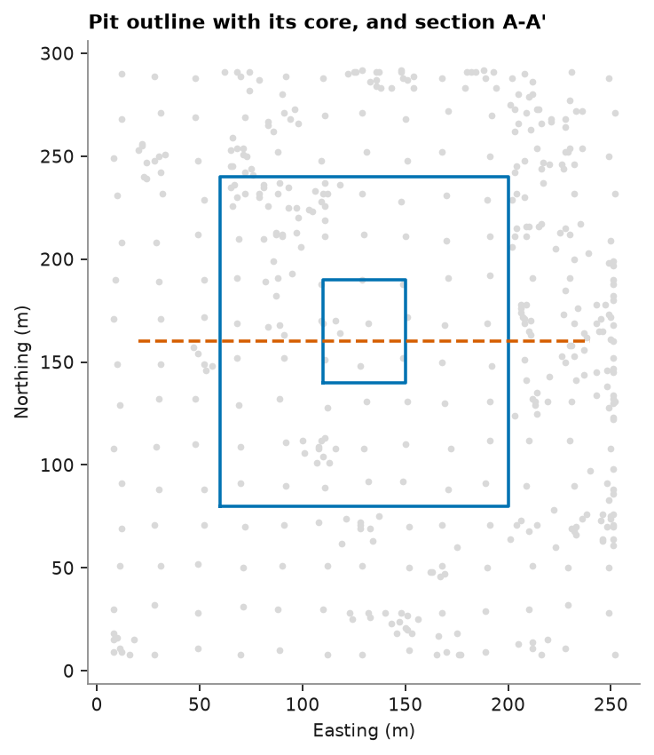

# Storing containers in parquet

`write_parquet` saves a `PointSet`, `BlockModel` or `Polylines` with its geometry, layout and CRS in the file
metadata, and `read_parquet` returns the same container. The file is ordinary parquet, so polars, pandas or duckdb
read it as a table. Fitted estimators and categorical estimates save the same way.

<details><summary>Python</summary>

```python
import tempfile

import boitata as bt
import matplotlib.pyplot as plt
import numpy as np
import polars as pl
from common import ACCENT, HIGHLIGHT, LIGHT, map_axes, save
```

</details>

The metal survey `V` is kriged on a 1 m grid with a variogram fitted in eight directions ([variogram fitting](../../05-spatial-continuity/02-variogram-fitting/README.md) explains the fit), and
a masked model keeps the cells above 500 ppm.

<details><summary>Python</summary>

```python
samples = bt.datasets.clustered_metal_survey()
azimuths = np.arange(0, 180, 22.5)
directional = [bt.experimental_variogram(samples, "V", 10.0, 120.0, azimuth=a) for a in azimuths]
model = bt.Variogram.fit_directional(
    directional, [(a, 0) for a in azimuths], ["spherical", "spherical"], weighting="count/gamma"
)
grid = bt.BlockModel(origin=(0.5, 0.5), size=(1, 1), count=(260, 300), crs="local grid")
kriging = bt.OrdinaryKriging(model, bt.Search(radius=100, max_samples=24, min_samples=4)).fit(samples, "V")
estimate, variance = kriging.predict(grid, return_variance=True)
grid = grid.with_column("estimate", estimate).with_column("variance", variance)
rich = grid.filter(grid["estimate"] > 500)
print(grid)
print(rich)
```

</details>

```text
BlockModel  regular, 78,000 blocks
  count   260 × 300 × 1
  size    1 × 1 × 1
  origin  0.5, 0.5, 0
  crs     local grid
  bounds  x 0.5 to 260.5, y 0.5 to 300.5, z 0 to 1
  column    type     unit  nulls     min     mean      max
  estimate  float64            0  0.5147    287.2   1368.6
  variance  float64            0  8835.1  44162.8  73477.1
BlockModel  masked, 10,155 of 78,000 blocks
  count   260 × 300 × 1
  size    1 × 1 × 1
  origin  0.5, 0.5, 0
  crs     local grid
  bounds  x 7.5 to 260.5, y 3.5 to 300.5, z 0 to 1
  column    type     unit  nulls     min     mean      max
  estimate  float64            0   500.1    643.4   1368.6
  variance  float64            0  9107.1  37382.9  57586.8
```

The masked model keeps 10155 of the 78000 cells and stores its cell index with the attributes.

<details><summary>Python</summary>

```python
folder = Path(tempfile.mkdtemp())
bt.write_parquet(folder / "grid.parquet", grid)
bt.write_parquet(folder / "rich.parquet", rich)
bt.write_csv(folder / "grid.csv", grid)
for name in ("grid.parquet", "rich.parquet", "grid.csv"):
    print(f"{name:>13}: {(folder / name).stat().st_size / 1e6:.2f} MB")

back = bt.read_parquet(folder / "rich.parquet")
print(back)
print("same cells:", np.array_equal(back.index, rich.index), "| crs:", back.crs)
```

</details>

```text
 grid.parquet: 1.03 MB
 rich.parquet: 0.14 MB
     grid.csv: 4.05 MB
BlockModel  masked, 10,155 of 78,000 blocks
  count   260 × 300 × 1
  size    1 × 1 × 1
  origin  0.5, 0.5, 0
  crs     local grid
  bounds  x 7.5 to 260.5, y 3.5 to 300.5, z 0 to 1
  column    type     unit  nulls     min     mean      max
  estimate  float64            0   500.1    643.4   1368.6
  variance  float64            0  9107.1  37382.9  57586.8
same cells: True | crs: local grid
```

The full grid takes 1.03 MB in parquet against 4.05 MB as CSV. Polars reads the same file and handles grouping and
summaries. A regular model stores no coordinates: its geometry is implicit and the row number is the cell index,
x fastest, so a 1 m row of 260 cells is one northing.

<details><summary>Python</summary>

```python
table = pl.read_parquet(folder / "grid.parquet")
bands = (
    table.with_columns((pl.int_range(pl.len()) // 260 // 50 * 50).alias("northing band"))
    .group_by("northing band")
    .agg(
        pl.col("estimate").mean().round(0).alias("mean V"),
        (pl.col("estimate") > 500).mean().round(3).alias("share > 500"),
    )
    .sort("northing band")
)
print(bands)
```

</details>

```text
shape: (6, 3)
┌───────────────┬────────┬─────────────┐
│ northing band ┆ mean V ┆ share > 500 │
│ ---           ┆ ---    ┆ ---         │
│ i64           ┆ f64    ┆ f64         │
╞═══════════════╪════════╪═════════════╡
│ 0             ┆ 204.0  ┆ 0.006       │
│ 50            ┆ 207.0  ┆ 0.006       │
│ 100           ┆ 250.0  ┆ 0.062       │
│ 150           ┆ 338.0  ┆ 0.236       │
│ 200           ┆ 374.0  ┆ 0.282       │
│ 250           ┆ 350.0  ┆ 0.189       │
└───────────────┴────────┴─────────────┘
```

A fitted estimator saves the same way. Its samples become columns, and its variogram, search and options go as
JSON in the file metadata. The estimator read back predicts the same values. `ImplicitModel` and
`LocalAnisotropy` save the same way.

<details><summary>Python</summary>

```python
kriging.to_parquet(folder / "kriging.parquet")
print(pl.read_parquet(folder / "kriging.parquet").head(3))
again = bt.OrdinaryKriging.from_parquet(folder / "kriging.parquet")
print("same estimates:", np.array_equal(again.predict(grid), estimate, equal_nan=True))
```

</details>

```text
shape: (3, 7)
┌──────┬──────┬─────┬───────┬──────┬────────────────┬────────┐
│ x    ┆ y    ┆ z   ┆ value ┆ hole ┆ error_variance ┆ domain │
│ ---  ┆ ---  ┆ --- ┆ ---   ┆ ---  ┆ ---            ┆ ---    │
│ f64  ┆ f64  ┆ f64 ┆ f64   ┆ f64  ┆ f64            ┆ f64    │
╞══════╪══════╪═════╪═══════╪══════╪════════════════╪════════╡
│ 12.0 ┆ 9.0  ┆ 0.0 ┆ 748.2 ┆ null ┆ 0.0            ┆ null   │
│ 28.0 ┆ 8.0  ┆ 0.0 ┆ 2.6   ┆ null ┆ 0.0            ┆ null   │
│ 49.0 ┆ 11.0 ┆ 0.0 ┆ 0.0   ┆ null ┆ 0.0            ┆ null   │
└──────┴──────┴─────┴───────┴──────┴────────────────┴────────┘
same estimates: True
```

A categorical estimate keeps its `Categories` scheme, the names and colors of the codes. The metal survey's type `T`
(1 and 2) is kriged as indicators on a 5 m grid ([categorical indicator kriging](../../07-categories-and-domains/05-categorical-indicator-kriging/README.md)). The file stores the probabilities as columns and
the scheme as JSON in the metadata.

<details><summary>Python</summary>

```python
scheme = bt.Categories(["T1", "T2"], mapping={1: "T1", 2: "T2"}, colors=[LIGHT, ACCENT])
types = bt.CategoricalIndicatorKriging(
    bt.Variogram([("spherical", 0.25, 60.0)]), bt.Search(radius=80, max_samples=16), scheme=scheme
).fit(samples, "T")
summary = types.predict(bt.BlockModel(origin=(2.5, 2.5), size=(5, 5), count=(52, 60)))
summary.to_parquet(folder / "types.parquet")
print(pl.read_parquet(folder / "types.parquet").head(3))
kept = bt.CategoricalIndicatorSummary.from_parquet(folder / "types.parquet")
print(
    "same scheme:",
    kept.scheme == scheme,
    "| same probabilities:",
    np.array_equal(kept.probabilities, summary.probabilities),
)
```

</details>

```text
shape: (3, 3)
┌────────────┬─────┬─────┐
│ correction ┆ p_0 ┆ p_1 │
│ ---        ┆ --- ┆ --- │
│ f64        ┆ f64 ┆ f64 │
╞════════════╪═════╪═════╡
│ 0.109905   ┆ 0.0 ┆ 1.0 │
│ 0.049994   ┆ 0.0 ┆ 1.0 │
│ 0.053672   ┆ 0.0 ┆ 1.0 │
└────────────┴─────┴─────┘
same scheme: True | same probabilities: True
```

Lines and polygons are `Polylines`: one attribute row per feature, each feature made of parts. A closed part is a
ring whose last vertex joins the first, and a ring inside another ring of the same feature is a hole. In parquet a
feature is one row whose `geometry` lists its parts, each a list of vertices. `Polylines.from_table` builds features
from a long table with one row per vertex.

<details><summary>Python</summary>

```python
pit = [[60, 80], [60, 240], [200, 240], [200, 80]]
core = [[110, 140], [150, 140], [150, 190], [110, 190]]
pits = bt.Polylines([pit, core], closed=True, features=[0, 0], attributes={"name": ["pit"]}, crs="local grid")
bt.write_parquet(folder / "pit.parquet", pits)
print(pl.read_parquet(folder / "pit.parquet"))
pits = bt.read_parquet(folder / "pit.parquet")
print(pits)

vertices = pl.DataFrame({"ID": ["A-A'", "A-A'"], "X": [20.0, 240.0], "Y": [160.0, 160.0]})
lines = bt.Polylines.from_table(vertices)
print(lines)

fig, ax = plt.subplots(figsize=(5, 5.2), layout="constrained")
ax.scatter(*samples.coords[:, :2].T, s=6, color=LIGHT)
for part, closed in zip(pits.parts, pits.closed):
    ring = np.vstack([part, part[:1]]) if closed else part
    ax.plot(ring[:, 0], ring[:, 1], color=ACCENT, lw=1.6)
for part in lines.parts:
    ax.plot(part[:, 0], part[:, 1], color=HIGHLIGHT, lw=1.6, ls="--")
map_axes(ax, "Pit outline with its core, and section A-A'")
save(fig, "polylines")
```

</details>

```text
shape: (1, 3)
┌──────┬─────────────────────────────────┬──────────────┐
│ name ┆ geometry                        ┆ closed       │
│ ---  ┆ ---                             ┆ ---          │
│ str  ┆ list[list[struct[3]]]           ┆ list[bool]   │
╞══════╪═════════════════════════════════╪══════════════╡
│ pit  ┆ [[{60.0,80.0,0.0}, {60.0,240.0… ┆ [true, true] │
└──────┴─────────────────────────────────┴──────────────┘
Polylines  1 feature, 2 parts
  closed  2 of 2 parts
  crs     local grid
  bounds  x 60 to 200, y 80 to 240, z 0 to 0
  column  type  unit  nulls  values
  name    str             0  1 unique: pit
Polylines  1 feature, 1 part
  closed  0 of 1 part
  bounds  x 20 to 240, y 160 to 160, z 0 to 0
  column  type  unit  nulls  values
  ID      str             0  1 unique: A-A'
```



Full script: [`example_01_04.py`](example_01_04.py)
