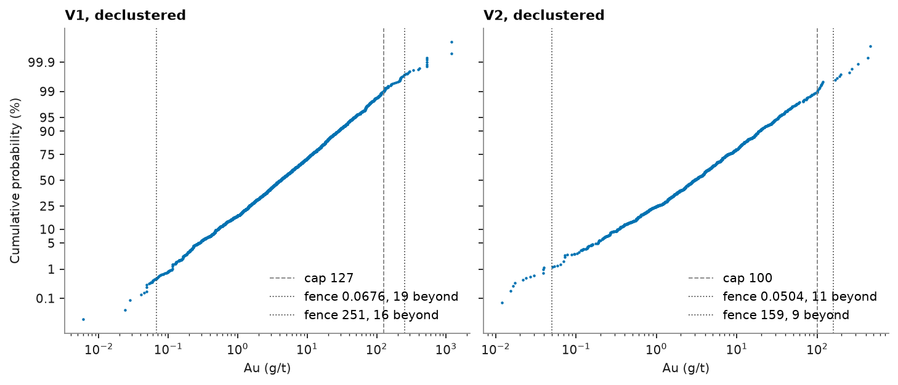

# Top cuts

Gold in four quartz veins, V1 to V4, sampled by diamond holes and underground channels. A handful of extreme assays
carry much of the metal, and one of them next to a block would lend it its grade. Capping the grades at a top cut
limits their influence. You need to decide where to cut and how much metal the cut costs.

<details><summary>Python</summary>

```python
import boitata as bt
import matplotlib.pyplot as plt
import numpy as np
from common import ACCENT, save

data = bt.datasets.vein_gold_grade_control()
intervals = bt.merge_intervals(data["assays"], data["lithology"])
holes = bt.Drillholes(data["collars"], data["surveys"], intervals)
composites = holes.composite(1.0, ["AU_GPT"], domain="LITH", categories=["VEIN"])
quartz = composites.filter(composites["LITH"] == "QV").drop_null("AU_GPT")
au = quartz["AU_GPT"]
print(f"{len(quartz)} composites of 1 m in quartz vein, mean Au {au.mean():.2f} g/t, max {au.max():.0f} g/t")
```

</details>

```text
6740 composites of 1 m in quartz vein, mean Au 12.35 g/t, max 1192 g/t
```

Channels crowd the developed levels, so the composites are first declustered in 20 m cells
([declustering](../../03-exploratory-analysis/03-declustering/README.md)).

<details><summary>Python</summary>

```python
weights = bt.cell_declustering(quartz, "AU_GPT", cell_size=20.0).weights
print(f"declustered mean Au {np.average(au, weights=weights):.2f} g/t")
```

</details>

```text
declustered mean Au 10.80 g/t
```

## How much metal sits in the tail

`capping` tries caps at high quantiles and reports, for each, the share of weight above it, the metal removed, and the
capped mean and CV.

<details><summary>Python</summary>

```python
caps = bt.capping("AU_GPT", weights=weights, data=quartz)
print(f"{'cap':>7}{'above (%)':>11}{'metal (%)':>11}{'mean':>7}{'CV':>6}")
for cap, above, metal, mean, cv in zip(*(caps[c] for c in caps.column_names), strict=True):
    print(f"{cap:>7.1f}{100 * above:>11.2f}{100 * metal:>11.1f}{mean:>7.2f}{cv:>6.2f}")
```

</details>

```text
    cap  above (%)  metal (%)   mean    CV
   24.1      10.00       36.2   6.89  1.11
   40.2       5.00       25.7   8.02  1.32
   67.0       2.50       17.3   8.94  1.55
  110.4       1.00       11.1   9.60  1.78
  157.8       0.50        8.2   9.92  1.94
  441.8       0.10        2.6  10.52  2.46
```

The top 1 % of the weight holds 11.1 % of the metal, and the top 10 % holds 36.2 %. The CV climbs from 1.11 at the
lowest cap to 2.46 at the highest: the tail makes gold grades erratic.

The log-probability plot shows where the tail breaks away from the body of the distribution. The dotted Tukey fences
sit 1.5 interquartile ranges beyond the quartiles of log Au, and the dashed line is a cap at the declustered P99 of
the vein.

<details><summary>Python</summary>

```python
stats = bt.describe_by("AU_GPT", "VEIN", weights=weights, quantiles=[0.5, 0.99], data=quartz)
top = dict(zip(stats["category"][:-1], stats["P99"][:-1], strict=True))
vein = quartz["VEIN"]
fig, axes = plt.subplots(1, 2, figsize=(9, 3.8), layout="constrained", sharey=True)
for ax, name in zip(axes, ["V1", "V2"], strict=True):
    keep = vein == name
    bt.plot.probability(
        au[keep], weights=weights[keep], log=True, cap=top[name], fences=1.5, ax=ax, color=ACCENT, ms=2
    )
    ax.set(title=f"{name}, declustered", xlabel="Au (g/t)")
    ax.legend(loc="lower right")
axes[1].set_ylabel("")
save(fig, "probability")
```

</details>



Both veins plot near a straight line (a lognormal body) up to about P99. Above it the points thin out, with the 1192
g/t channel alone at the top of V1. The upper fences, at 251 and 159 g/t, sit a little above the caps at P99.

## One cap per vein

`capping_report` applies one cap per domain and compares the declustered statistics before and after, with the metal
removed; the last row pools the veins.

<details><summary>Python</summary>

```python
report = bt.capping_report("AU_GPT", top, domain_column="VEIN", weights=weights, data=quartz)
columns = ["domain", "cap", "n", "n_capped", "mean", "mean_capped", "cv", "cv_capped"]
print(
    f"{'vein':<5}{'cap':>7}{'n':>6}{'cut':>5}{'mean':>7}{'capped':>8}{'CV':>6}{'capped':>8}{'metal (%)':>11}"
)
for name, c, n, cut, mean, capped, cv, cv_capped in zip(*(report[k] for k in columns), strict=True):
    shown = "" if np.isnan(c) else f"{c:.1f}"
    print(
        f"{name:<5}{shown:>7}{n:>6.0f}{cut:>5.0f}{mean:>7.2f}{capped:>8.2f}{cv:>6.2f}{cv_capped:>8.2f}"
        f"{100 * (1 - capped / mean):>11.1f}"
    )
```

</details>

```text
vein     cap     n  cut   mean  capped    CV  capped  metal (%)
V1     126.7  4961   53  12.84   11.26  3.17    1.77       12.3
V2     100.1  1553   18   8.82    8.00  2.65    1.86        9.2
V3      52.7   119    0   6.34    6.34  1.47    1.47        0.0
V4     131.9   107    2  10.23   10.13  2.03    1.99        1.0
all           6740   73  10.80    9.69  3.07    1.83       10.3
```

The caps cut 53 composites in V1 and 18 in V2, and remove 12.3 % and 9.2 % of their metal. Pooled, the veins lose
10.3 % of the metal and the CV falls from 3.07 to 1.83. V3 and V4 hold about a hundred composites each, too few for a
P99 to mean much: in V3 it is the maximum and cuts nothing. Cap a small domain with the cap of a similar, larger one.

Full script: [`example_03_05.py`](example_03_05.py)
