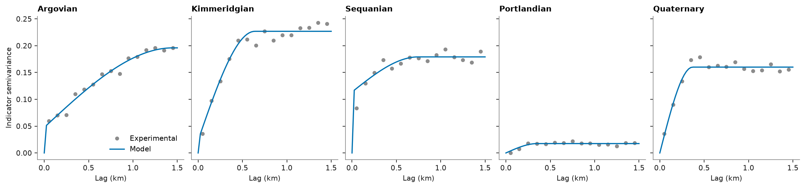
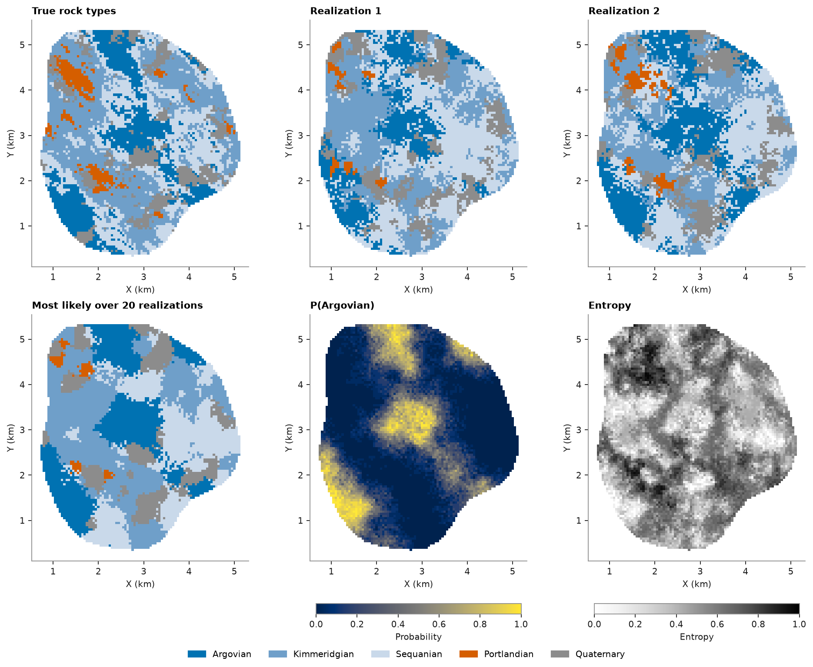

# Sequential indicator simulation

Sequential indicator simulation (SIS) draws categories. It visits the nodes along a random path, krigs the indicator
of each category with its own variogram from the samples and the nodes already drawn, and draws a category from
those probabilities. Each realization is one possible rock-type map; over many realizations, the frequency of each
category at a node is its probability. [Categorical indicator kriging](../../07-categories-and-domains/05-categorical-indicator-kriging/README.md) estimates such probabilities without
simulating.

<details><summary>Python</summary>

```python
import boitata as bt
import matplotlib.pyplot as plt
import numpy as np
from common import ACCENT, GRAY, save
```

</details>

## Rock types

The topsoil survey's rock types are known at each node of the prediction grid, so you can compare simulated maps with the real
geology. A `Categories` scheme names the five types and gives each a color: `encode` turns labels into the codes 0
to 4 that SIS takes, and `shares` gives their proportions.

<details><summary>Python</summary>

```python
data = bt.datasets.topsoil_metals()
train, grid = data["prediction"], data["grid"]
names = ["Argovian", "Kimmeridgian", "Sequanian", "Portlandian", "Quaternary"]
rock_types = bt.Categories(names, colors=["#0072b2", "#6f9fc9", "#c9d9ea", "#d55e00", "#8c8c8c"])
rock = rock_types.encode(train["Rock"]).astype(int)
true_rock = rock_types.encode(grid["Rock"]).astype(int)
print(f"{len(rock)} samples, {len(true_rock)} grid nodes")
print(f"{'':<13}{'samples':>8}{'share':>7}{'true grid':>11}")
for k, name in enumerate(names):
    print(f"{name:<13}{np.sum(rock == k):8d}{np.mean(rock == k):7.2f}{np.mean(true_rock == k):11.2f}")
```

</details>

```text
259 samples, 6751 grid nodes
              samples  share  true grid
Argovian           54   0.21       0.19
Kimmeridgian       85   0.33       0.35
Sequanian          61   0.24       0.28
Portlandian         5   0.02       0.05
Quaternary         54   0.21       0.13
```

## Indicator variograms

Each rock type gets the variogram of its indicator, 1 inside the type and 0 outside. Portlandian has too few
samples for an experimental variogram, so it gets a short spherical model with the indicator's variance as sill.

<details><summary>Python</summary>

```python
experimental, variograms = [], []
for k in range(5):
    indicator = (rock == k).astype(float)
    if indicator.sum() >= 5:
        experimental.append(bt.experimental_variogram(train.coords, indicator, 0.1, 1.5))
        variograms.append(experimental[-1].fit("spherical"))
    else:
        experimental.append(None)
        variograms.append(bt.Variogram([("spherical", indicator.var(), 0.5)]))
for name, v in zip(names, variograms):
    s = v.structures[0]
    print(f"{name:<13}nugget {v.nugget:.3f}, sill {s.sill:.3f}, range {s.range:.2f} km")
```

</details>

```text
Argovian     nugget 0.048, sill 0.148, range 1.45 km
Kimmeridgian nugget 0.024, sill 0.203, range 0.64 km
Sequanian    nugget 0.114, sill 0.065, range 0.75 km
Portlandian  nugget 0.000, sill 0.018, range 0.35 km
Quaternary   nugget 0.000, sill 0.160, range 0.37 km
```

<details><summary>Python</summary>

```python
h = np.linspace(0, 1.5, 61)
fig, axes = plt.subplots(1, 5, figsize=(14, 3.2), layout="constrained", sharey=True)
for ax, name, e, v in zip(axes, names, experimental, variograms):
    if e is not None:
        ax.plot(e.lags, e.gammas, "o", color=GRAY, ms=4, label="Experimental")
    ax.plot(h, v.gamma(h), color=ACCENT, label="Model")
    ax.set(title=name, xlabel="Lag (km)")
axes[0].set_ylabel("Indicator semivariance")
axes[0].legend(loc="lower right")
save(fig, "variograms")
```

</details>



## Realizations

`simulate` returns a summary over `n` realizations: `probabilities` holds each type's frequency, one row per node,
`most_likely` the most frequent type, and `entropy`, scaled to [0, 1], how evenly the realizations disagree.
`keep=True` keeps the maps.

<details><summary>Python</summary>

```python
sis = bt.SIS(variograms, bt.Search(radius=1.5, max_samples=16)).fit(train, rock)
summary = sis.simulate(grid, n=20, seed=3, keep=True)
maps = summary.realizations
shares = np.array([rock_types.shares(m) for m in maps])
print(f"{'':<13}{'true grid':>10}{'mean':>7}{'min':>7}{'max':>7}")
for k, name in enumerate(names):
    print(
        f"{name:<13}{np.mean(true_rock == k):10.2f}{shares[:, k].mean():7.2f}"
        f"{shares[:, k].min():7.2f}{shares[:, k].max():7.2f}"
    )
match = np.mean(maps == true_rock, axis=1)
print(f"a realization matches the true rock type at {match.min():.0%} to {match.max():.0%} of the nodes")
print(
    f"the most likely type matches at {np.mean(summary.most_likely == true_rock):.0%}; "
    f"mean entropy {summary.entropy.mean():.2f}"
)
```

</details>

```text
              true grid   mean    min    max
Argovian           0.19   0.22   0.18   0.26
Kimmeridgian       0.35   0.30   0.24   0.34
Sequanian          0.28   0.29   0.25   0.35
Portlandian        0.05   0.02   0.01   0.04
Quaternary         0.13   0.17   0.13   0.20
a realization matches the true rock type at 47% to 52% of the nodes
the most likely type matches at 60%; mean entropy 0.50
```

<details><summary>Python</summary>

```python
cmap, norm = bt.plot.category_colors(rock_types)
xy = grid.coords[:, :2].T
fig, axes = plt.subplots(2, 3, figsize=(12, 9.5), layout="constrained")
categorical = [(true_rock, "True rock types"), (maps[0], "Realization 1"), (maps[1], "Realization 2")]
for ax, (cats, title) in zip(axes[0], categorical):
    ax.scatter(*xy, c=cats, cmap=cmap, norm=norm, s=7, marker="s", linewidths=0)
    ax.set_title(title)
axes[1, 0].scatter(*xy, c=summary.most_likely, cmap=cmap, norm=norm, s=7, marker="s", linewidths=0)
axes[1, 0].set_title("Most likely over 20 realizations")
for ax, values, title, label, color in (
    (axes[1, 1], summary.probabilities[:, 0], "P(Argovian)", "Probability", "cividis"),
    (axes[1, 2], summary.entropy, "Entropy", "Entropy", "Greys"),
):
    im = ax.scatter(*xy, c=values, s=7, marker="s", linewidths=0, vmin=0, vmax=1, cmap=color)
    ax.set_title(title)
    fig.colorbar(im, ax=ax, shrink=0.8, orientation="horizontal", label=label)
for ax in axes.flat:
    ax.set_aspect("equal")
    ax.set(xlabel="X (km)", ylabel="Y (km)")
bt.plot.category_legend(rock_types, fig, loc="outside lower center", ncol=5)
save(fig, "realizations")
```

</details>



Each realization matches the true rock type at 47 % to 52 % of the nodes, and two realizations differ wherever the
samples leave room. On average the proportions stay within 0.05 of the true grid, and Portlandian falls short: no
realization recovers its 5 % of the area from 5 of 259 samples. The most likely type matches at 60 %, more than any
realization, though it is a smooth estimate and no possible map looks like it. Entropy peaks at the contacts and
far from the samples.

Full script: [`example_07_06.py`](example_07_06.py)
